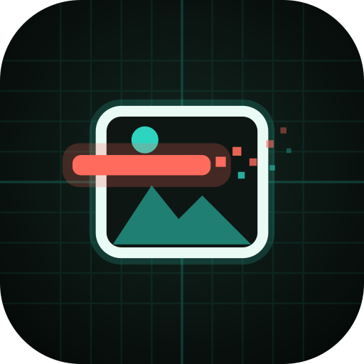

<p align="center">
  
</p>

<h1 align="center">Cybermeta for Android</h1>

<p align="center">
  <b>Your photos talk. Make them stop.</b><br>
  See what your photos give away, then remove it without losing a pixel.
</p>

<p align="center">
  <a href="https://cybercoretech.github.io/cybermeta-android-app/">Site →</a> ·
  <a href="https://github.com/cybercoretech/cybermeta-android-app/releases/latest">Download →</a> ·
  <a href="https://github.com/cybercoretech/cybermeta">cybermeta CLI →</a>
</p>

[](https://github.com/cybercoretech/cybermeta-android-app/actions/workflows/ci.yml)

## 📸 What it does

A photo carries much more than the picture. Cybermeta reads a photo and
reports what it gives away, grouped by how much it reveals:

| | Finding | Examples |
|---|---|---|
| 📍 | **Where you were** | EXIF GPS, GPS copied into XMP, IPTC city/country |
| 👤 | **Who you are** | Camera owner, artist, XMP creator and contact details, IPTC by-line |
| 🎞️ | **Hidden data** | Motion-photo video stored after the image, Multi-Picture data |
| 📷 | **Your camera** | Body/lens serial numbers, unique image ID, maker notes, make/model |
| 🕒 | **When** | Capture time to the second, time zone, edit times |
| 🖼️ | **Hidden preview** | Embedded thumbnails that can still show what you cropped out |
| ✍️ | **Captions and comments** | Descriptions, comments, PNG text |
| 🧰 | **Software and settings** | Editing apps, exposure settings |

It then makes clean copies to share, save, or write over the originals.

## 🧽 Clean modes

| Mode | What goes | What stays |
|---|---|---|
| **Share-safe** (default) | Everything | Colour profile and rotation (you can toggle each, plus the capture date) |
| **Location only** | GPS, plus XMP/IPTC blocks that name a place | Everything else |
| **Anonymous camera** | Everything | Rotation, colour, date; the camera reads *Generic Camera* |
| **Pixels only** | Everything, including colour profile and rotation | The picture |
| **Shift dates** | XMP/IPTC and the GPS clock | EXIF times, moved by your offset (`-1d`, `+3h30m`) |

## 🛡️ Why you can trust it

- 🌐 **No INTERNET permission.** It's removed in the manifest with
  `tools:node="remove"`, and CI fails if a dependency ever adds it back.
  The app can't send your photos anywhere.
- 🧪 **Verified clean.** The engine rebuilds each file from its picture
  data, then a second, independent parser re-reads the result. If anything
  but what you kept is left, the photo fails with a reason instead of
  being shared.
- 🎯 **Lossless.** The compressed picture is copied byte for byte. HEIC and
  AVIF are the exception: they're converted to a high-quality JPEG first,
  you're told, and it can be turned off.
- 🔏 **Originals untouched by default.** Copies go to the share sheet or to
  `Pictures/Cybermeta`. Overwriting originals goes through Android's own
  *Allow Cybermeta to modify* prompt for exactly the photos you picked.
- 🏷️ **Random file names.** Camera names like `IMG_20261019_143022` give
  away the time, so clean copies are named `photo_7f3a21.jpg` (you can turn
  this off).
- 📍 **Honest reports.** Android hides GPS from apps unless they're allowed
  *media location*. Cybermeta asks for that permission, so it can show you
  the location it's about to remove, and warns you when it can't see it.

## 📦 Install

**On the phone:** download `cybermeta.apk` from the
[latest release](https://github.com/cybercoretech/cybermeta-android-app/releases/latest)
and open it. Requires Android 11 or newer.

**From a terminal** (Linux, macOS, Termux):

```bash
curl -fsSL https://raw.githubusercontent.com/cybercoretech/cybermeta-android-app/main/install.sh | sh
```

The script downloads the APK and verifies its SHA-256 and the signing
certificate. It then installs over `adb` if a phone is connected (it asks
first), opens Android's installer on Termux, or leaves the verified APK in
the current folder.

Release signing certificate (SHA-256):

```
88:39:05:95:F5:FB:F1:71:DC:03:D0:40:AB:C8:ED:C2:A7:FB:9E:97:33:20:B3:C4:BB:E7:25:D4:13:9B:28:3C
```

For update notifications, add `https://github.com/cybercoretech/cybermeta-android-app`
to [Obtainium](https://github.com/ImranR98/Obtainium).

## 🎨 Themes

There are 82 palettes: the cybermeta brand palette **Tag Redact** plus all
81 CYBERGRID themes from the Cybercore framework, in *Settings → CYBERGRID
theme*. `tools/sync-cybergrid.py` regenerates `Palettes.kt` from
`cybercore/schema/themes`. Don't edit that file by hand.

## 🧱 How it's built

```
app/  Kotlin + Jetpack Compose UI ─┐
                                   │ UniFFI bindings (generated at build time)
rust/ cybermeta-ffi ───────────────┤ thin owned-data wrappers
                                   │
cybermeta (git dependency) ────────┘ the same engine as the desktop CLI/TUI,
                                     built with default-features = false
```

- **`rust/`** is the bridge crate, with `audit_photo`, `scrub_photo`,
  `strip_location`, `anonymous_camera` and `shift_dates`. It takes bytes in
  and returns plain records out; the app reads content URIs in Kotlin.
- **Gradle** builds the Rust side itself:
  - `cargoNdk` builds `libcybermeta_ffi.so` for arm64-v8a and x86_64.
  - `cargoHost` builds a host copy.
  - `uniffiBindings` generates the Kotlin API from it.
  - AGP strips the libraries when it packages the APK (the APK is about
    8.7 MB).
- **JVM unit tests** load the host library through JNA. That way they test
  the real engine, not a mock.

### Build it yourself

```bash
rustup target add aarch64-linux-android x86_64-linux-android
cargo install cargo-ndk
export ANDROID_HOME=~/android ANDROID_NDK_HOME=~/android/ndk/30.0.16248370
./gradlew :app:testDebugUnitTest :app:lintDebug :app:assembleDebug
```

Release builds are signed when all four `CYBERMETA_RELEASE_*` environment
variables are set (store file, store password, key alias, key password).
The key itself never lives in this repository.

## 🌐 The site

`docs/` is the GitHub Pages site. It has an animated hero, leak cards with
detail pop-ups, a **live lab** that audits and scrubs a JPEG entirely in
the browser, a phone demo, a comparison table, install commands, and the
CYBERGRID theme picker. Nothing is uploaded and there are no trackers.

## 📜 License

MIT, Copyright (c) 2026 Cybercore Tech. Independent open-source utility
under the Cyber prefix; no affiliation with any external cybersecurity
vendor or agency.

Contact: dev@cybercoretech.net
